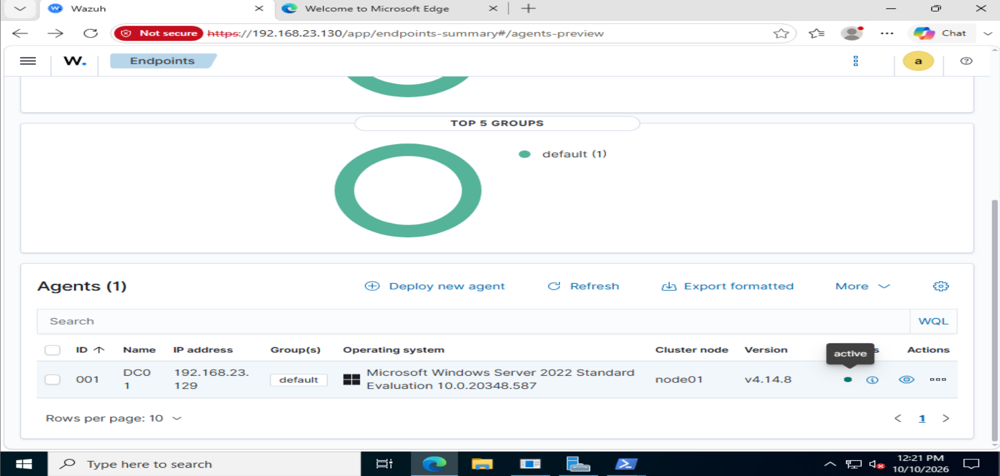
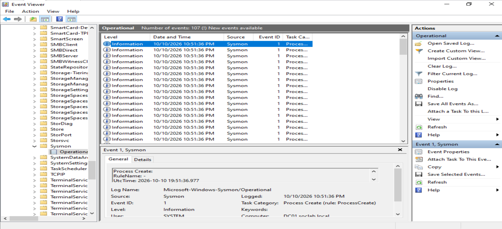

# 02 - Windows Server Domain Controller Deployment

## Objective

The second phase of the SOC home lab establishes the Windows enterprise identity and endpoint telemetry infrastructure.

A Windows Server 2022 virtual machine was deployed as the first domain controller in the lab.

The server provides:

- Active Directory Domain Services
- DNS
- Domain authentication
- Windows security logging
- Wazuh telemetry
- Sysmon endpoint telemetry

The Active Directory domain created for the lab is:

```text
soclab.local
```

---

## Host System

The domain controller is hosted on the desktop system.

- CPU: AMD Ryzen 5 7600
- RAM: 32 GB
- Host OS: Windows
- Hypervisor: VMware Workstation Pro

---

## Virtual Machine Configuration

A VMware virtual machine named `DC01` was created with:

- Operating System: Windows Server 2022 Standard Evaluation
- Interface: Desktop Experience
- RAM: 4 GB
- vCPU: 2
- Disk: 60 GB
- Network Mode: NAT

---

## Windows Server Installation

Windows Server 2022 Standard Evaluation with Desktop Experience was installed manually from an ISO image.

The server hostname was changed to:

```text
DC01
```

Server Manager was used to verify the system identity.

---

## Active Directory Domain Services

The following Windows Server roles were installed:

- Active Directory Domain Services
- DNS Server

The server was then promoted to a domain controller.

A new Active Directory forest was created using:

```text
soclab.local
```

`DC01` became the first domain controller for the new forest.

---

## Domain Validation

After promotion and reboot, the domain configuration was validated using PowerShell.

The following commands were executed:

```powershell
whoami
hostname
$env:USERDNSDOMAIN
```

The results confirmed:

```text
User: soclab\administrator
Hostname: DC01
Domain: SOCLAB.LOCAL
```

---

## Active Directory Validation

Active Directory Users and Computers was opened to verify the new domain.

The console successfully displayed:

```text
soclab.local
```

This confirmed that Active Directory Domain Services was operational.

---

## Wazuh Server Migration

The previously deployed `SOC-WAZUH01` virtual machine was copied to the desktop environment.

After migration, the Wazuh services were verified:

```bash
sudo systemctl status wazuh-manager
sudo systemctl status wazuh-indexer
sudo systemctl status wazuh-dashboard
```

All services were confirmed to be active and running.

The Wazuh server address was:

```text
192.168.23.130
```

---

## Connectivity Validation

`DC01` was using:

```text
192.168.23.129
```

Connectivity from `DC01` to the Wazuh server was tested using PowerShell.

```powershell
Test-NetConnection 192.168.23.130 -Port 443
```

and:

```powershell
Test-NetConnection 192.168.23.130 -Port 1514
```

Both tests returned:

```text
TcpTestSucceeded : True
```

This confirmed connectivity to:

- TCP 443 - Wazuh Dashboard
- TCP 1514 - Wazuh Agent communication

---

## Wazuh Agent Deployment

The Wazuh Windows agent was deployed on `DC01`.

The agent was configured to use:

```text
Manager Address: 192.168.23.130
Agent Name: DC01
```

The Wazuh service was verified using:

```powershell
Get-Service WazuhSvc
```

The service status was:

```text
Running
```

The agent configuration was also checked:

```powershell
Get-Content "C:\Program Files (x86)\ossec-agent\ossec.conf" |
Select-String "address"
```

The configured manager address was:

```text
192.168.23.130
```

The Wazuh dashboard then displayed `DC01` as an active endpoint.



This confirmed that the Wazuh manager could successfully communicate with the Windows Server endpoint.

---

## Time Configuration

The Windows Server time zone was corrected to:

```text
(UTC+03:00) Kuwait, Riyadh
```

The time zone was configured using:

```powershell
Set-TimeZone -Id "Arab Standard Time"
```

and verified using:

```powershell
Get-TimeZone
Get-Date
```

Accurate time configuration is important because security investigations depend on correctly ordered timestamps across multiple telemetry sources.

These sources will later include:

- Windows Security logs
- Sysmon
- Wazuh
- Suricata
- Network telemetry
- Attack simulation systems

---

## Sysmon Deployment

Sysmon was installed on `DC01` to provide richer endpoint telemetry than standard Windows logging alone.

The Sysmon binaries and configuration file were placed in the same local directory.

The installation command used was:

```powershell
.\Sysmon64.exe -accepteula -i .\sysmonconfig.xml
```

The Sysmon service was then verified using:

```powershell
Get-Service *Sysmon*
```

Sysmon began writing events to:

```text
Applications and Services Logs
→ Microsoft
→ Windows
→ Sysmon
→ Operational
```

---

## Sysmon Validation

Process creation telemetry was validated locally using Windows Event Viewer.

The Sysmon Operational log showed:

```text
Event ID 1
```

which represents:

```text
Process Create
```



This confirmed that Sysmon was installed correctly and was actively generating endpoint telemetry.

---

## Wazuh Sysmon Integration

The Wazuh agent was configured to collect the Sysmon Operational event channel.

The following configuration was added to:

```text
C:\Program Files (x86)\ossec-agent\ossec.conf
```

```xml
<localfile>
  <location>Microsoft-Windows-Sysmon/Operational</location>
  <log_format>eventchannel</log_format>
</localfile>
```

The Wazuh service was then restarted:

```powershell
Restart-Service WazuhSvc
```

---

## Sysmon Telemetry in Wazuh

Sysmon telemetry was validated in Wazuh Discover.

The following query was used:

```text
agent.name:DC01 AND data.win.system.eventID:1
```

The query returned multiple Sysmon process creation events from `DC01`.

The events originated from:

```text
Microsoft-Windows-Sysmon/Operational
```

This confirmed the complete telemetry path:

```text
Process Execution
        |
        v
      Sysmon
        |
        v
Windows Event Log
        |
        v
   Wazuh Agent
        |
        v
   Wazuh Manager
        |
        v
Detection Rules
        |
        v
MITRE ATT&CK Mapping
        |
        v
Wazuh Dashboard
```

---

## Initial Detection Observations

Wazuh immediately began applying detection logic to Sysmon Event ID 1 activity.

One observed activity involved:

```text
net.exe
net1.exe
```

executing:

```text
net user
```

Wazuh mapped this behavior to:

```text
T1087 - Account Discovery
```

Another observed activity involved PowerShell launching:

```text
secedit.exe
```

Wazuh mapped this activity to:

```text
T1059.001 - PowerShell
```

Some observed PowerShell activity was also associated with:

```text
T1070.004 - File Deletion
```

---

## Investigation Context

The events initially appeared suspicious because commands such as:

```text
net user
powershell
secedit
```

can also appear during reconnaissance and post-exploitation activity.

However, investigation showed that several of the events had the parent process:

```text
C:\Program Files (x86)\ossec-agent\wazuh-agent.exe
```

and were executed as:

```text
NT AUTHORITY\SYSTEM
```

This indicated that the activity was being generated by the Wazuh agent while performing security assessment operations.

This demonstrates an important SOC principle:

```text
Alert != Incident
```

Detection rules identify potentially suspicious behavior, but analysts must review the surrounding context before deciding whether activity is malicious.

Relevant context includes:

- Parent process
- Process tree
- Command line
- User
- Integrity level
- Execution source
- Host role
- Expected security-tool behavior

---

## Current DC01 Telemetry Status

The following components are operational:

- [x] Windows Server 2022
- [x] Active Directory Domain Services
- [x] DNS Server
- [x] `soclab.local`
- [x] Wazuh Agent
- [x] Windows telemetry forwarding
- [x] Sysmon
- [x] Sysmon Event ID 1 collection
- [x] Sysmon forwarding to Wazuh
- [x] Wazuh detection rule processing
- [x] MITRE ATT&CK mapping

---

## Current Architecture

```text
Desktop
|
+-- VMware Workstation Pro
    |
    +-- SOC-WAZUH01
    |   |
    |   +-- Ubuntu Server 24.04
    |   +-- Wazuh Manager
    |   +-- Wazuh Indexer
    |   +-- Wazuh Dashboard
    |
    +-- DC01
        |
        +-- Windows Server 2022
        +-- Active Directory
        +-- DNS
        +-- soclab.local
        +-- Wazuh Agent
        +-- Sysmon
```

---

## Result

`DC01` is now a monitored Windows domain controller with enhanced endpoint telemetry.

The environment can now:

- Generate native Windows logs
- Generate Sysmon telemetry
- Forward endpoint telemetry to Wazuh
- Apply Wazuh detection rules
- Map activity to MITRE ATT&CK
- Support investigation of suspicious process activity

This marks the transition from basic infrastructure deployment to an operational SOC monitoring environment.

---

## Next Steps

- Configure advanced Windows audit policies
- Create Active Directory organizational units
- Create lab users and groups
- Deploy `WIN11-01`
- Join `WIN11-01` to `soclab.local`
- Install Wazuh agent on `WIN11-01`
- Install Sysmon on `WIN11-01`
- Deploy Kali Linux
- Perform first controlled attack simulation
- Investigate resulting telemetry
- Document the first complete SOC incident investigation
